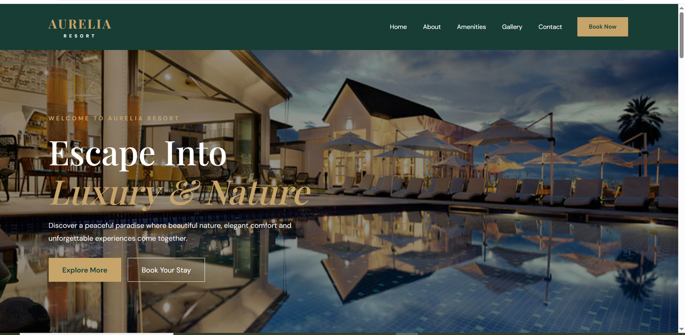
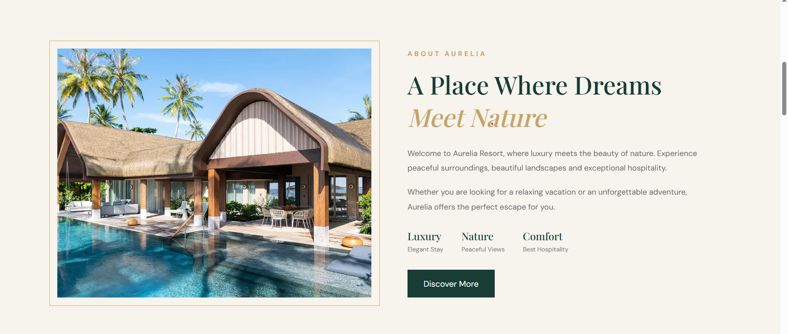
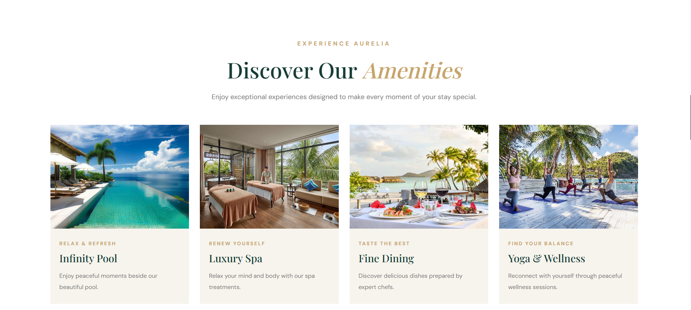
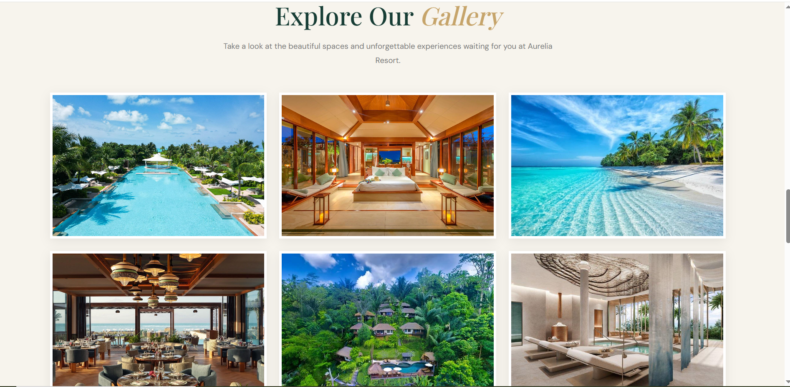
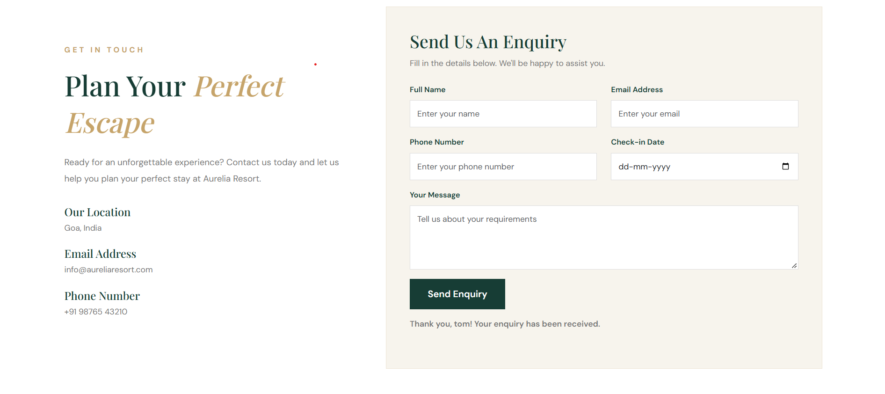

# Aurelia Resort Website

Aurelia Resort is a modern, responsive luxury resort landing page designed to provide visitors with an elegant and premium browsing experience.

# Features

- Attractive hero section with a call-to-action
- About the resort section
- Amenities and activities section
- Resort image gallery
- Contact and enquiry form with JavaScript validation
- Responsive navigation and layout
- Elegant footer section

# Technologies Used

- HTML5
- CSS3
- Bootstrap 5
- JavaScript

# Project Structure

Aurelia-Resort-Website/
├── index.html
├── style.css
├── script.js
└── images.jpa

# How to Run

1. Clone or download this repository.
2. Open the project folder in Visual Studio Code.
3. Open `index.html` using Live Server.
4. Explore the Aurelia Resort website.

# Website Preview

1. Home Page

2. About Section

3. Amenities Section

4. Gallery Section

5. Contact Section

6. CTA Section

# Live Demo

https://bhoomika28lb-bit.github.io/Aurelia-Resort-Website/

# Developed By

Designed and developed as part of a Web Developer assignment using HTML, CSS, Bootstrap 5, and JavaScript.
